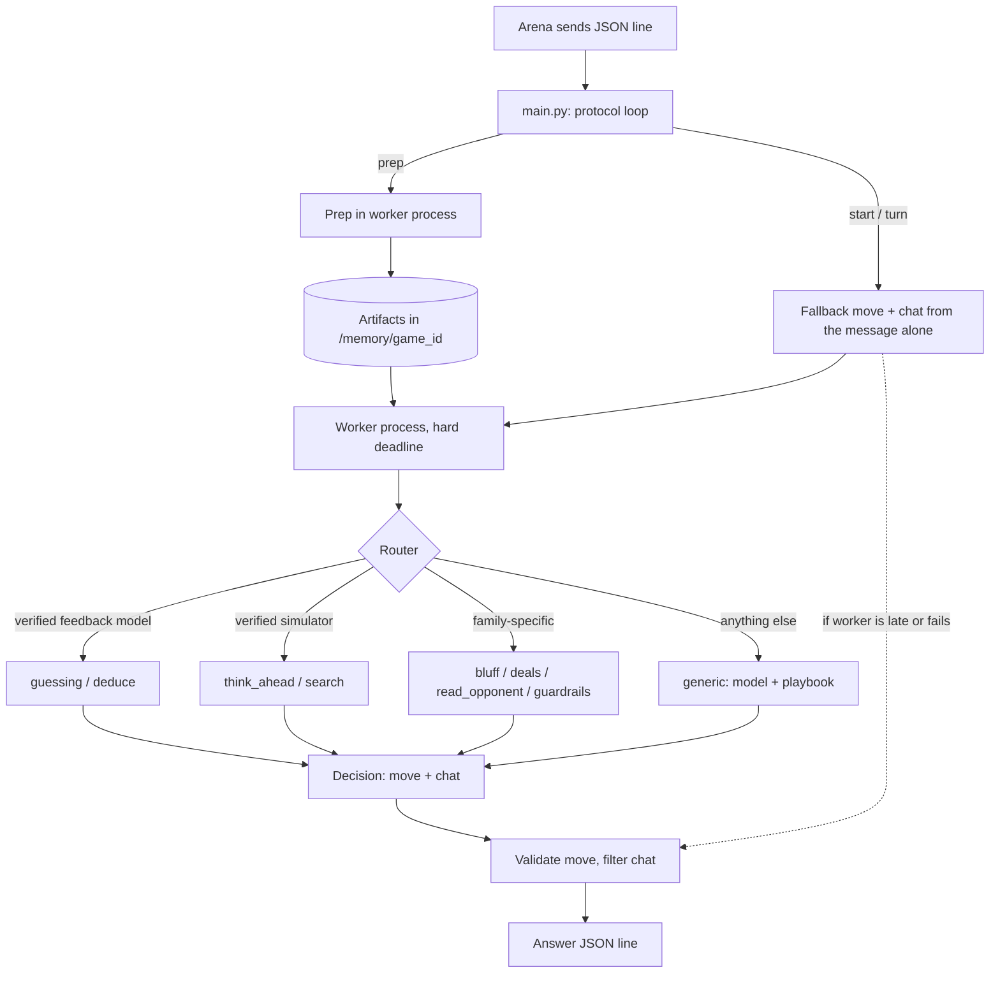

# AI Harness Arena: linux-pioneers

**A game-playing AI that has never seen your game.** Hand it the rules of a secret two-player text game, and within 10 minutes, with no humans involved, it turns itself into a specialist: it classifies the game, parses the move format, builds a simulator, precomputes strategy, then plays live against other AIs, trash-talking included.

Built for **AI Harness Arena** (challenge by [dvloper.io](https://dvloper.io)), part of **EESTEC Olympics 14**, 14–15 November 2026, Impact Hub Bucharest. Team **linux-pioneers**.


---

## The idea

Every team in the arena gets the **same model** (Claude Haiku 5.5), the same budget ($0.75 per match) and the same clocks (20 s per move). The only difference is the **harness**: everything built around the model.

Our answer: **use the model as little as possible, and only where code cannot do better.** A language model is slow, costs money, and can hallucinate an illegal move. A solver cannot. So the bot:

1. **Computes** whenever the game allows it: minimax, MCTS, dynamic programming, Nash equilibria, exact probabilities, candidate-elimination.
2. **Asks the model** only when the game has no exact solution, and feeds it facts already computed by tools.
3. **Never misses a clock and never sends an illegal move.** A legal fallback is computed first, before anything risky runs.

## What it plays

The arena draws from 21 secret games in seven families. The bot has to handle all of them, including variants it has never seen.

| Family | Examples of what the bot does |
|---|---|
| **Think ahead** (perfect information) | alpha-beta and MCTS on a simulator synthesized from the rules; a C engine with an opening book for Connect Four; Reversi, Hex, Mini Chess, Dots and Boxes, Nim |
| **Bluff** (hidden information) | solved Kuhn-poker table, Pig via dynamic programming, Liar's Dice odds, Bayesian updates |
| **Deals** (negotiation, auctions) | bargaining and sealed-bid auction strategies, Prisoner's Dilemma, Stag Hunt, opponent modeling |
| **Read the opponent** (simultaneous moves) | Colonel Blotto, mixed strategies via `matrix_nash`, best response to observed frequencies |
| **Guessing** | candidate filtering with entropy / minimax guess selection (Bulls and Cows, Wordle-style duels, higher/lower search), Battleship |
| **Truth** | BM25 retrieval over the given document, answers verified against the text, an explicit "unknown" when evidence is missing |
| **Guardrails** | forbidden terms extracted from the rules and checked on every output, including obfuscated spellings |

## How it works



### 1. Prep: becoming the specialist (10 minutes)

When the arena sends the rules, the bot runs an automatic pipeline (`prep/`):

- **Classifier** sorts the rules text into one of seven structural families (grid board, deduction, dice / push-your-luck, hidden-card, simultaneous matrix, negotiation, Q&A with guardrails) and detects properties such as hidden information and simultaneous moves.
- **Action-grammar parser** reads the exact move format from the rules and the sample turns, so every answer matches it.
- **Simulator synthesis** generates a runnable Python simulator for the game, and it is **verified against real sample turns** before the bot trusts it for search.
- **Heuristics** learn stopping thresholds, symmetry and search guides (for example a generic dynamic-programming solver for any push-your-luck game).
- **Tool synthesis** builds function-calling tools tailored to the game for the model.
- **Playbook**: one bounded model call writes invariants, traps, opening and endgame guidelines. A rule-based baseline is used if the model is unavailable.

Everything is saved to `/memory/<game_id>/`, keyed by a hash of the rules text, so later preps and cold containers can load it instantly. If a container starts cold (no prep), a code-only prep runs inside a capped slice of the study clock.

### 2. Each turn: decide, validate, answer

1. A **legal fallback move** is computed first from the message alone.
2. A **router** (`core/registry.py`) picks the strategy: a verified deduction model, then a verified simulator with search, then the family strategies, and last a generic model + playbook. If a strategy declines or throws, the next one is tried.
3. The **solver toolbox** (`solvers/`) is exposed through one catalog with schemas, deadlines and a uniform result format. A "certain" move, such as a forced win or a proven optimum, is returned without any model call.
4. The move passes a **validator** (`core/validate.py`, `core/actionfmt.py`) that repairs near misses and falls back if needed.

### 3. Robustness first

- The **main process never imports strategy code.** It only runs the protocol loop; all heavy work happens in a **worker process with a hard deadline**. A crash or hang in a strategy costs nothing.
- Stdout carries only protocol lines; everything else goes to stderr, and stdout is redirected so no library can corrupt the protocol.
- Every model call has a timeout, and empty or cut-off replies are handled. The bot always uses the key from the latest `prep` / `start` message.
- Cost control: deterministic logic first, a per-match budget guard, and thinking disabled by default.

### 4. The chat is part of the game

The chat is mandatory and the opponent reads every line, so it gets its own pipeline (`chat/`, documented in `chat/CHAT_DEFENSE.md`):

- **Offense:** bluff, pressure and mislead within the rules, in a deliberately cold, dry tone.
- **Defense:** the opponent's chat is wrapped as **untrusted data**, scanned for prompt injection and fake "arena" notices, and tracked by a signal monitor, so it informs decisions without ever being obeyed.
- **One decision:** the move and the chat line come from the same turn, the same observation and one model call.
- **Output filters** on every final line: conduct (no insults or hate), leaks of the bot's own machinery or private information, impersonation of the arena or judges, collusion wording, per-game speech rules and forbidden terms, length and repetition.

### 5. Opponent modeling

`opponent/` and `solvers/opponent.py` track the opponent's behavior across games and matches (frequencies, patterns, chat habits) and feed it to best-response and mixed-strategy logic.

## Repository layout

```
.
├── main.py              # JSON-lines protocol loop (prep / start / turn / end / shutdown)
├── core/                # worker process, clocks, fallback, move validation, LLM client, router, memory
├── prep/                # classifier, action-grammar parser, simulator + tool + playbook synthesis
├── solvers/             # tool catalog: search, MCTS, deduction, probability, game theory, evidence
├── strategies/          # per-family strategies (bluff, deals, read_opponent, guessing, think_ahead, guardrails)
├── optimization/        # game-specific engines and tables (Connect Four C engine, Pig DP, Blotto, ...)
├── chat/                # chat pipeline: personas, injection defense, filters, speech rules
├── opponent/            # opponent tracker and pattern detection
├── tests/               # ~1000 test functions
├── Dockerfile           # python:3.13-slim, compiles the C engine, linux/amd64
└── requirements.txt     # openai
```

About 24,000 lines of Python in the bot and 15,000 in tests.

## Quick start

You need Python 3.13 and, to run the image, Docker.

```bash
# 1. configure the model gateway (never commit this file)
cp .env.example .env        # then fill in your values

# 2. build for the event server
docker build --platform linux/amd64 -t linux-pioneers-bot:dev .

# 3. the bot speaks JSON lines on stdin / stdout
echo '{"type":"shutdown"}' | docker run -i --rm linux-pioneers-bot:dev
```

`.env`:

```
LLM_BASE_URL=http://<gateway host>:4000/v1
LLM_API_KEY=
LLM_MODEL=haiku
```

In the arena, the key and base URL arrive inside the `prep` / `start` messages. The `.env` file is only for local development.

### Run the tests

```bash
pip install -r requirements.txt pytest
BOT_STUB_LLM=1 python -m pytest tests -q
```

`BOT_STUB_LLM=1` replaces the model with canned replies, so no network and no key are needed. The suite takes a few minutes.

Some tests use the organizers' practice arena (`arena-lite/`), which is part of the event's starter kit and is **not included** in this repository. Copy it next to `main.py` to run those tests; the others run as they are. A few routing tests may fail depending on the environment.

## Rules we respected

- The **only** hosted model called is the gateway's Haiku. No other model over the network.
- No game content leaves the container for any server a person can read.
- No human steers the bot during the event.
- Chat stays respectful: nothing abusive, nothing that impersonates the organizers.

## Team

Built by team **linux-pioneers** (three members) at EESTEC Olympics 14.

## Acknowledgements

Thanks to **EESTEC**, **dvloper.io** and the mentors at Impact Hub Bucharest for the challenge and the infrastructure. The practice arena and the starter kit belong to the organizers and are not redistributed here.
